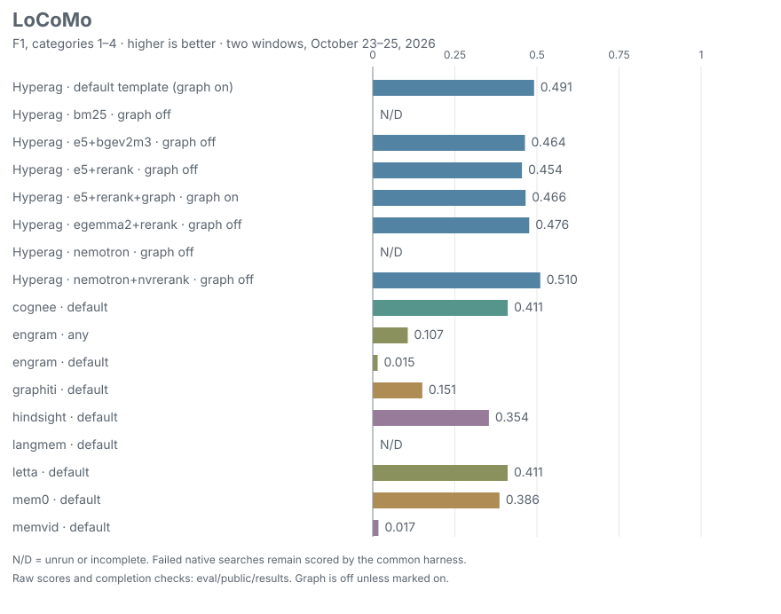
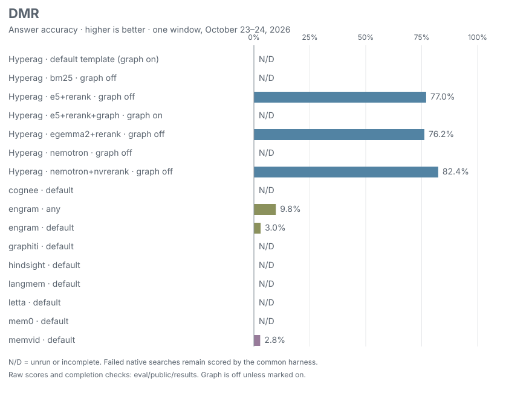
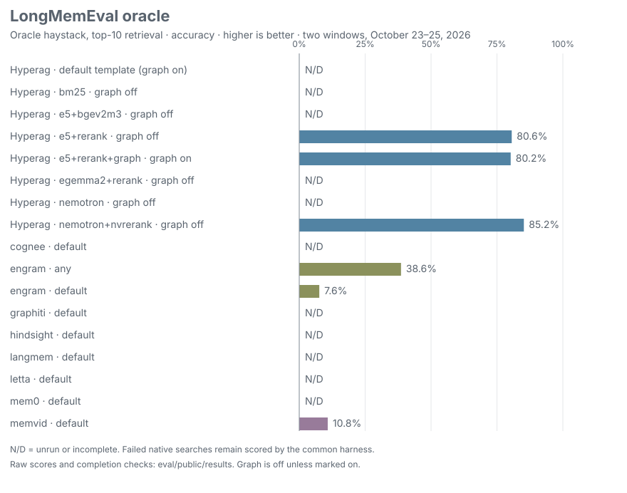
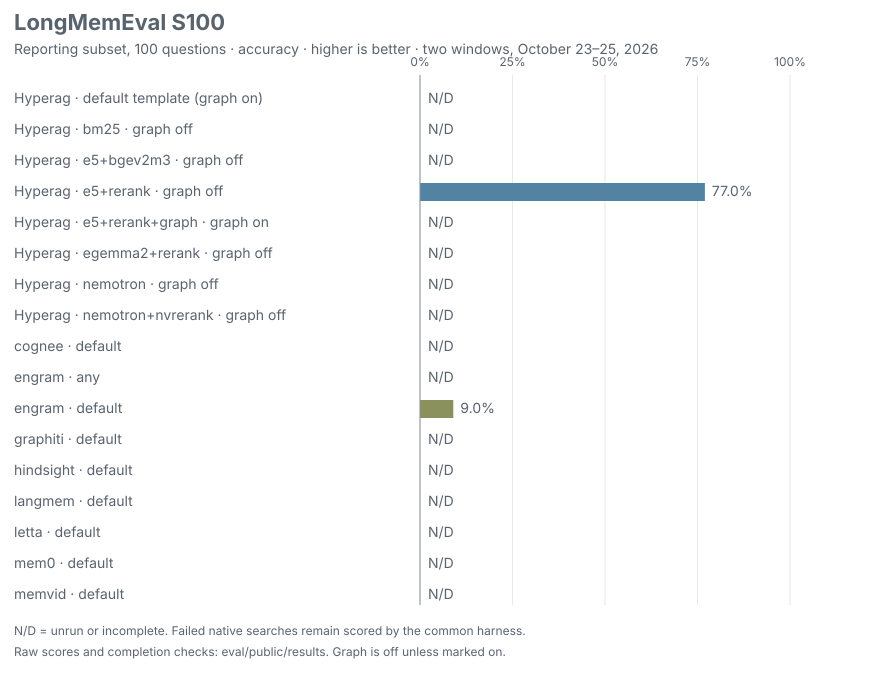
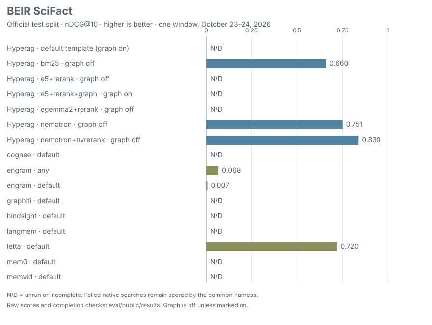
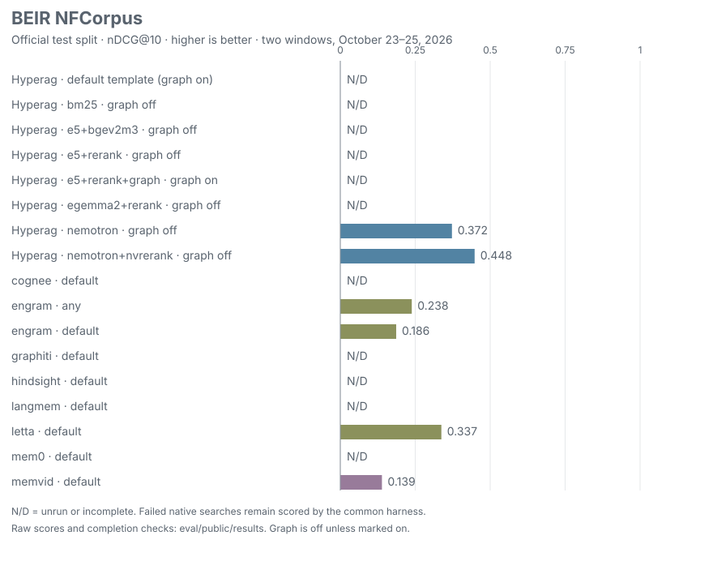
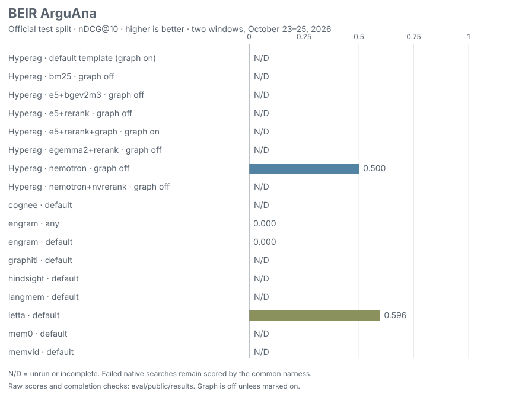

<picture>
  <source media="(prefers-color-scheme: dark)" srcset="assets/brand/logo/lockup-color-dark.svg">
  <source media="(prefers-color-scheme: light)" srcset="assets/brand/logo/lockup-color.svg">
  
</picture>

Modular RAG and shared memory for agents.

Shared memory and retrieval for agents, with permissions, version history and cited context.

## Install

With Homebrew:

```sh
brew install ogarciarevett/tap/hyperag
```

Or with the standalone installer:

```sh
curl -fsSL https://raw.githubusercontent.com/ogarciarevett/hyperag/main/scripts/install.sh | sh
```

Verify:

```sh
~/.local/bin/hyperag --version
```

The installer downloads a prebuilt binary and checks its SHA-256. [Windows, Homebrew, source and package options](docs/install.md). [v0.2.0 binary assets are published](https://github.com/ogarciarevett/hyperag/releases/tag/v0.2.0).

[](https://github.com/ogarciarevett/hyperag/actions/workflows/ci.yml) [](LICENSE)

## Run a local stack

The binary needs Postgres with pgvector. The full template also uses Neo4j.
The pinned source path below requires the `v0.2.1` tag, planned after
[the git-package build fix](https://github.com/ogarciarevett/hyperag/pull/49) merges;
it is not available until that tag is published. To run everything together then:

```sh
git clone --branch v0.2.1 --depth 1 https://github.com/ogarciarevett/hyperag && cd hyperag
docker compose -p hyperag --profile service up -d
```

The service listens on loopback port 7480. First startup downloads the pinned local embedding and re-ranking models. Container passwords in this example are deliberately fake; configure your own credentials before hosting a shared service.

```sh
# Create an admin token and an agent token. Each is shown once; keep them private.
ADMIN=$(docker compose -p hyperag exec -T hyperag hyperag token admin --file /config/tokens.json)
AGENT=$(docker compose -p hyperag exec -T hyperag hyperag token agent-a --file /config/tokens.json)

# Grant this agent read and write access to a scope.
for permission in read write; do
  curl -fsS localhost:7480/v1/grants -H "authorization: Bearer $ADMIN" -H 'content-type: application/json' \
    -d "{\"principal\":\"agent-a\",\"scope\":\"team\",\"permission\":\"$permission\"}"
done

# Save a decision, then retrieve cited context.
curl -fsS localhost:7480/v1/memories -H "authorization: Bearer $AGENT" -H 'content-type: application/json' \
  -d '{"scope":"team","source":"demo","text":"Failed jobs retry three times with exponential backoff."}'
curl -fsS localhost:7480/v1/context -H "authorization: Bearer $AGENT" -H 'content-type: application/json' \
  -d '{"query":"How many times do failed jobs retry?"}'
```

The result names each memory's version, source and author. The MCP server exposes the same operations using the agent's token; see [MCP setup](docs/mcp.md).

## Why modular

- Combine BM25, vector search, typed graph relations and re-ranking in one retrieval pipeline.
- Choose embeddings and re-ranking independently; each embedding space has its own vector index.
- Use Neo4j for relationships or turn graph expansion off; Postgres keeps the source text and versions.
- Integrate through HTTP, MCP or `hyperag/plugin`; your application supplies the answer model.

[Module interfaces and backend limits](docs/modules.md) · [Runnable module examples](#module-examples)

## What it does

- Server-side grants control every search, context and graph path. Revocation takes effect on the next query.
- Corrections retain versions and valid times. Concurrent updates report conflicts instead of silently overwriting each other.
- BM25 and vector retrieval use reciprocal-rank fusion, optional typed graph expansion and re-ranking.
- Context includes numbered citations or an `insufficientEvidence` signal when evidence is weak.
- Models run locally from pinned revisions. Store, embedding, re-ranking and graph slots can be configured independently.

## Module examples

These TypeScript examples run from a reviewed source checkout with Bun, Postgres/pgvector
and Neo4j. Pin the example checkout to the reviewed revision containing these files,
start only the databases, then run all seven examples:

```sh
git clone https://github.com/ogarciarevett/hyperag hyperag-readme && cd hyperag-readme
git checkout --detach 739111e80b5e1802908f11721c41ac247f4592fe
docker compose -p hyperag-readme up -d postgres neo4j
bun install --frozen-lockfile && bun run build
bun examples/readme/run.ts
```

Use the database ports in [docker-compose.yml](docker-compose.yml), or set
`HYPERAG_PG_URL`, `HYPERAG_NEO4J_URL` and `HYPERAG_NEO4J_PASSWORD` for disposable
local services. First re-ranking use downloads the pinned TypeScript reference model.
This path is separate from the installed Rust service above.

The shared [`demo`](examples/readme/demo.ts) harness creates and drops a fresh database,
provisions a scoped test identity and private token file, starts the reference HTTP
service on a temporary loopback port, then cleans up. No example uses 7481 or 7482.
`call` sends an authenticated HTTP request and rejects non-200 responses. Every block
below is the complete file linked above it; CI checks that they stay identical.
Run an individual file with `bun examples/readme/<name>.ts` after the same setup.

### Ingest a document

Store document text with its source and scope. File parsing and chunking belong to the caller.

[`examples/readme/ingest.ts`](examples/readme/ingest.ts)

```ts
import assert from "node:assert/strict";
import { demo } from "./demo";

await demo(async ({ call, scope }) => {
  const saved = await call<{ id: string; version: number; created: boolean }>("/v1/memories", {
    scope, source: "retry-policy.md", text: "Failed jobs retry three times with exponential backoff.",
  });
  assert.equal(saved.version, 1);
  assert.equal(saved.created, true);
});
```

### Search with citations

Retrieve context within a token budget; honor `insufficientEvidence` before answering.

[`examples/readme/search.ts`](examples/readme/search.ts)

```ts
import assert from "node:assert/strict";
import type { Context, Retrieval, WriteResult } from "../../src/index";
import { demo } from "./demo";

await demo(async ({ call, scope }) => {
  const saved = await call<WriteResult>("/v1/memories", {
    scope, source: "retry-policy.md", text: "Failed jobs retry three times with exponential backoff.",
  });
  const context = await call<Context & { retrieval: Retrieval }>("/v1/context", {
    query: "Failed jobs retry", maxTokens: 400,
  });
  assert.equal(context.retrieval.insufficientEvidence, false);
  assert.equal(context.citations[0]?.memoryId, saved.id);
  console.log(context.text);
});
```

### Relate nodes

Create a typed edge between two saved memories. The caller needs write access on `from` and read access on `to`.

[`examples/readme/relate.ts`](examples/readme/relate.ts)

```ts
import assert from "node:assert/strict";
import type { Relation, WriteResult } from "../../src/index";
import { demo } from "./demo";

await demo(async ({ call, scope }) => {
  const save = (text: string) => call<WriteResult>("/v1/memories", { scope, source: "operations.md", text });
  const evidence = await save("The migration lock timed out after 30 seconds.");
  const finding = await save("Raise the migration lock timeout to 120 seconds.");
  await call("/v1/relations", { from: finding.id, to: evidence.id, type: "SUPPORTED_BY" });
  const edges = await call<Relation[]>(`/v1/memories/${encodeURIComponent(finding.id)}/relations`);
  assert(edges.some((edge) => edge.to === evidence.id && edge.type === "SUPPORTED_BY"));
});
```

### Re-rank candidates

Configure a local cross-encoder independently of embeddings. Retrieval runs it after fusion.

[`examples/readme/rerank.ts`](examples/readme/rerank.ts)

```ts
import assert from "node:assert/strict";
import { createLocalReranker, type Retrieval } from "../../src/index";
import { demo } from "./demo";

await demo(async ({ call, scope }) => {
  for (const text of ["Failed jobs retry three times.", "Failed jobs appear in the monitoring dashboard."])
    await call("/v1/memories", { scope, source: "operations.md", text });
  const ranked = await call<Retrieval>("/v1/retrieve", { query: "How many times do failed jobs retry?" });
  assert.equal(ranked.items.length, 2);
  assert(ranked.pathsUsed.some((path) => path.startsWith("rerank:")));
  assert(ranked.items.every((item) => Number.isFinite(item.rerankScore)));
}, { reranker: createLocalReranker({ threads: 1 }) });
```

### Import the plugin in another app

For another app, install the immutable git tag after `v0.2.1` is published following
[PR #49](https://github.com/ogarciarevett/hyperag/pull/49):

```sh
bun add --exact github:ogarciarevett/hyperag#v0.2.1
```

Once the npm release is published, use `npm install --save-exact hyperag@0.2.1`.
The public `hyperag/plugin` import calls the same service. In a host, supply your service URL and a private token file provisioned by its administrator; see [the plugin contract](docs/plugin.md) for packaging and permissions.

[`examples/readme/plugin.ts`](examples/readme/plugin.ts)

```ts
import assert from "node:assert/strict";
import { loadPlugin } from "hyperag/plugin";
import { demo } from "./demo";

await demo(async ({ url, tokenFile, scope }) => {
  const memory = await loadPlugin({ url, tokenFile });
  await memory.health();
  const saved = await memory.save({ scope, source: "host-app", text: "Failed jobs retry three times." });
  const context = await memory.search("Failed jobs retry", { maxTokens: 400 });
  assert.equal(context.citations[0]?.memoryId, saved.id);
});
```

### Swap the embedding backend

Reindex into an OpenAI-compatible embedding space, then construct and serve an instance using it. The suite supplies a deterministic loopback provider with three dimensions; this tests the adapter contract, not model quality or a live provider. For an individual run, set `README_EMBEDDING_URL` to a compatible endpoint serving `example-embedding` with three dimensions, or adapt the model metadata to your endpoint.

[`examples/readme/embeddings.ts`](examples/readme/embeddings.ts)

```ts
import assert from "node:assert/strict";
import { Hyperag, createOpenAICompatibleEmbedder, type Retrieval, type WriteResult } from "../../src/index";
import { demo } from "./demo";

await demo(async ({ hyperag, store, serve, call, scope }) => {
  const saved = await call<WriteResult>("/v1/memories", { scope, source: "policy.md", text: "Failed jobs retry three times." });
  const embedder = createOpenAICompatibleEmbedder({
    baseUrl: process.env.README_EMBEDDING_URL!, model: "example-embedding", revision: "v1",
    dimensions: 3, normalized: true,
  });
  const indexed = await hyperag.reindex(embedder);
  assert.equal(indexed.embedded, 1);
  const next = new Hyperag({ store, embedder, graph: null });
  await next.init(); // reindex alone does not switch the running instance.
  serve(next);
  const result = await call<Retrieval>("/v1/retrieve", { query: "retry", channels: { bm25: false, graph: false } });
  assert(result.pathsUsed.includes("vector"));
  assert.equal(result.items[0]?.memory.id, saved.id);
});
```

### Choose the graph backend

Neo4j is the only built-in graph backend; the relation example above exercises it. Set `graph: null` to disable expansion, as below. The TypeScript library accepts a custom `GraphStore` implementation, but no alternative adapter, edge migration or runtime graph-switch API is supplied.

[`examples/readme/graph.ts`](examples/readme/graph.ts)

```ts
import assert from "node:assert/strict";
import type { Retrieval } from "../../src/index";
import { demo } from "./demo";

// Neo4j is the built-in backend (used by relate.ts); null disables the graph slot.
await demo(async ({ call, scope }) => {
  await call("/v1/memories", { scope, source: "policy.md", text: "Failed jobs retry three times." });
  const result = await call<Retrieval>("/v1/retrieve", { query: "retry" });
  assert.equal(result.items.length, 1);
  assert(!result.pathsUsed.includes("graph"));
  assert(result.limitations.some((limit) => limit.includes("no graph configured")));
}, { graph: null });
```

## Benchmarks

Two evaluation windows, October 23–25, 2026. These figures use only completed runs and display **N/D** for unrun or unfinished rows. The default template has graph enabled; the other Hyperag rows explicitly label graph on/off. These are observations, with no confidence intervals or broad quality claim.



*LoCoMo token F1 over categories 1–4. Every competitor and Hyperag variant is shown; missing results remain unscored.*













How measured: all memory systems use the same answer/judge harness. LoCoMo completes 1,986 questions, with F1 reported over 1,540 category 1–4 questions. DMR and oracle-haystack LongMemEval use 500 questions; S100 uses the fixed 100-question reporting subset. Oracle means a top-10 search over the oracle haystack, not upstream oracle-session retrieval. SciFact uses all 300 official test queries and nDCG@10. Failed native searches remain in scoring; graph-off rows are not the default template.

[Window 1 results](eval/public/results/window-2026-10-24.json) · [Window 2 scores and completion evidence](eval/public/results/window-2026-10-25.json) · [BEIR raw scores](eval/public/results/beir-scores.json) · [Window 1 details](eval/public/notes/window-2026-10-24.md) · [Window 2 details](eval/public/notes/window-2026-10-25.md) · [Final row statuses](eval/public/notes/next-window.md).

No full 500-question LME-S run completed. Outstanding comparisons include several competitors on DMR/oracle/S100, INT8 profiles, endpoint-blocked native tool calls and unfinished BEIR datasets. Partial attempts are not zeros. The full LME-S includes development questions and is not a held-out temporal score; see the [temporal protocol](docs/temporal.md).

Regenerate the figures from result metadata:

```sh
python3 -I eval/public/benchmark_charts.py
```

Graph experiments use two deterministic conversation rules: link each turn to its previous session turn, and link successive mentions of the same extracted entity. BEIR documents have no supplied relationships, so merely enabling graph adds no corpus edges. See [the exact graph rules](eval/public/conversation-graph.ts).

## Architecture

**Rust** (`crates/hyperag`) is the installed product: one binary provides the HTTP service, MCP server, CLI, local models and database adapters.

**TypeScript** (`src/`) is the reference library and HTTP implementation, retained for parity checks and library consumers. The benchmark runners and adapters in `eval/` use TypeScript and Python so every system shares question loading, retrieval budgets and scoring. The TypeScript library is being prepared for npm distribution; running the Rust binary does not require it.

Postgres 18 with pgvector stores versions, grants, BM25 statistics and separate vector indexes per embedding space. Neo4j 5.26 Community supplies typed graph expansion. The default model slots are pinned EmbeddingGemma 2 q8 and bge-reranker-v2-m3 q8; `hyperag models recommend` suggests alternatives for the resources free on your machine. Hyperag returns evidence; your application supplies the answer model.

## Developer tooling

The TypeScript SDK/tooling requires Node 24.22.1 and TypeScript 7.0.2.
Optional Python benchmark environments require uv >=0.13.4 and use the
CA constraints in `eval/public/python-ca-constraints.txt`. Run
`sh scripts/bootstrap-python-ca.sh python3` with Python >=3.10 to bootstrap
hash-verified pip 26.2.2, certifi >=2026.10.19 and uv >=0.13.4 before package downloads.
This does not rerun or change recorded benchmark results.

## Docs

[Modules](docs/modules.md) · [Plugin](docs/plugin.md) · [Install](docs/install.md) · [Concepts](docs/concepts.md) · [Configuration](docs/configuration.md) · [API](docs/api.md) · [MCP](docs/mcp.md) · [Hosting](docs/cloud.md) · [Export and import](docs/export.md) · [Models](docs/models.md) · [Architecture](docs/architecture.md) · [Status and limits](docs/status.md) · [FAQ](docs/faq.md) · [Contributing](CONTRIBUTING.md)

Apache-2.0. See [LICENSE](LICENSE) and [NOTICE](NOTICE).

## Shared harness hooks

With `hyperag` installed and `HYPERAG_TOKEN` set in the harness environment:

```sh
hyperag hooks install --harness all
```

Install merges hooks into existing user profiles. Missing profile directories and unknown
harness names are skipped. Use `--harness claude-code,codex` to select targets or `--dry-run`
to preview owned entries without writing or printing unrelated settings. `hyperag hooks status` checks recorded entries locally;
it does not verify service connectivity or whether a harness has enabled/trusted them.
`hyperag hooks uninstall` removes the recorded handlers and preserves unrelated settings
and hooks, including handlers added later to the same group. Edited handlers are preserved.
Both install and uninstall save unique sibling `*.hyperag-backup-*` copies before changes;
keep those backups private because existing settings may contain credentials.

Every handler runs the installed executable's absolute path with `hyperag hook <event>`.
Re-run install after moving/upgrading the executable. Setup records ownership in
`~/.config/hyperag/hooks-installed.json`; keep this file until uninstall completes.
Avoid running an older plugin hook setup alongside these subscriptions to prevent duplicate events.

The shared file is `~/.config/hyperag/hooks.toml` (`$XDG_CONFIG_HOME/hyperag/hooks.toml`
when set). Install creates it with defaults; hooks also work when it is absent:

```toml
# Environment overrides: HYPERAG_URL and HYPERAG_SCOPE.
url = "http://127.0.0.1:7480"
# Environment variable NAME, never a literal token.
token_env = "HYPERAG_TOKEN"
# Optional absolute owner-only 0600 JSON credential file; overrides token_env.
# token_file = "/absolute/path/to/hook-credential.json"
# "project" => project:<lowercase-git-root-folder>; otherwise a fixed scope.
scope = "project"
# Overall deadline, including stdin, in milliseconds (100..2000).
timeout_ms = 1500

[events]
session-start = true
prompt = true
session-end = true

# Repeat for claude-code, codex, cursor, gemini, or kimi.
[harnesses.codex]
enabled = true
events = ["session-start", "prompt", "session-end"]
```

All supported harnesses and events are enabled by default. Event/harness switches apply
at runtime; re-run install to reconcile the native subscriptions. Session start fetches
recent context, prompt stores up to 4,000 characters, and session end stores a marker.
The token comes from the named environment variable, or the optional private `token_file`,
and is never copied into generated settings. Native hooks use a current-thread runtime;
every scope call fetches fresh permissions, without a local grant cache. See the
[native hook path and hosted measurement](integrations/hooks/FAST_PATH.md).
Gemini's [environment redaction](https://geminicli.com/docs/hooks/best-practices/#sanitize-environment)
filters token names. Setup adds only `token_env` to
`security.environmentVariableRedaction.allowed`, retaining other allowance/block lists
and the redaction switch. This exposes that variable to Gemini's local hook/tool processes;
uninstall removes only an allowance added by this setup. Re-run install after changing
`token_env`; pre-existing allowances are preserved.
Malformed input, missing credentials, service errors and timeouts exit 0; Cursor and Gemini
receive valid JSON, including on failure. Network work shares the overall deadline.
These command adapters target local POSIX shells.

| Harness | User config | Native events: start / prompt / end | Notes and current format docs |
| --- | --- | --- | --- |
| Claude Code | `~/.claude/settings.json` | `SessionStart` / `UserPromptSubmit` / `SessionEnd` | [Grouped command hooks](https://code.claude.com/docs/en/hooks); restart the session after setup. |
| Codex | `~/.codex/config.toml` | `SessionStart` / `UserPromptSubmit` / `SessionEnd` | [Inline TOML hooks](https://learn.chatgpt.com/docs/hooks); review/trust new definitions in `/hooks`. `features.hooks = false` prevents execution. |
| Cursor | `~/.cursor/hooks.json` | `sessionStart` / `beforeSubmitPrompt` / `sessionEnd` | [Version 1 command hooks](https://cursor.com/docs/hooks); [CLI lifecycle support](https://cursor.com/docs/cli/changelog) depends on the version. User hooks do not transfer to cloud agents. |
| Gemini CLI | `~/.gemini/settings.json` | `SessionStart` / `BeforeAgent` / `SessionEnd` | [Grouped command hooks](https://geminicli.com/docs/hooks/); `hooksConfig.enabled = false` prevents execution. Native timeout values use milliseconds. |
| Kimi Code CLI | `~/.kimi-code/config.toml` | `SessionStart` / `UserPromptSubmit` / `SessionEnd` | [Flat `[[hooks]]` rules](https://www.kimi.com/code/docs/en/kimi-code-cli/customization/hooks.html); legacy `~/.kimi` profiles are skipped. |
| OpenCode | — | — | Skipped: its [JavaScript plugin API](https://opencode.ai/docs/plugins/) requires a separate adapter. |

Native timeout fields use three seconds (3,000 milliseconds for Gemini), above the shared
two-second maximum. Existing feature flags, hook disable lists, alternate profile locations,
plugins and trust settings are preserved. `status` reports configuration presence rather
than live harness execution. Check the harness's own hooks panel/logs after enabling it.

The installer contract suite uses only temporary HOME directories and a synthetic loopback
service; it never starts a harness or uses live profiles:

```sh
# Python 3.11+ and Node 22.18+ (for the pinned Gemini sanitizer fixture).
HYPERAG_BIN=target/release/hyperag python3 crates/hyperag/tests/hooks_install.py
```

Host integrations can load the remote client from `hyperag/plugin`; see the [plugin contract](docs/plugin.md) and [example host](examples/plugin-host.ts).
