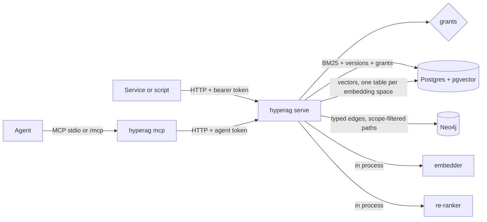

# Architecture

One query:

1. The token maps to a principal; the principal's readable scopes come from the grants table.
2. BM25 (Postgres full text, statistics over the readable corpus only) and vector search (pgvector HNSW in the active embedding space) run over current, active, readable versions.
3. Reciprocal rank fusion (k = 60) merges them; the top 8 seed a graph expansion of up to two hops, keeping only paths whose every node is readable.
4. Graph hits are re-checked in Postgres, the re-ranker (if set) re-orders, the evidence rule decides `insufficientEvidence`.
5. `context` packs passages into the token budget, each with a numbered citation.

Writes are transactions in Postgres (versions, supersede locks, idempotency keys); graph writes are idempotent MERGEs repeated on retry. The MCP server holds no state: every tool call goes to the service with the agent's own token.
